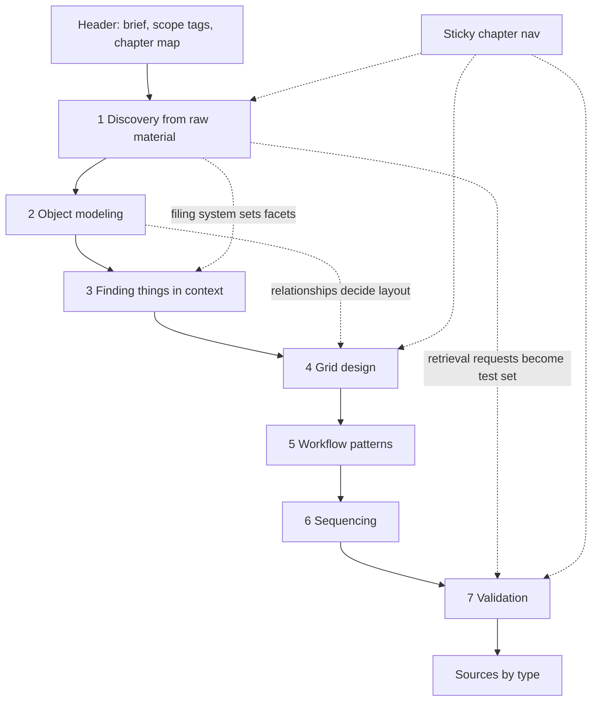
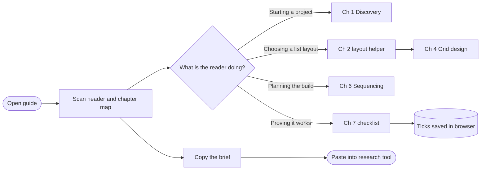
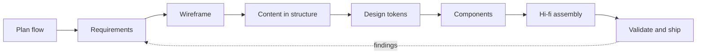

# styling-by-example

Applying WCAG 2.1 AA / ADA Title II styling to a template by example as each step progresses.

**[View the live page →](https://jamfin92.github.io/styling-by-example/)**

A build template that shows one website being made, from its brief to a finished page. Each band down the page is one stage of the work, and each band is styled only as far as the project had got at that stage. The top looks like a browser with no CSS. The bottom looks like the shipped site. The page shows the process as it describes it.

The example website is a practitioner's guide to replacing a paper-based government workflow with a web application. Its brief is the research prompt at the end of this README.

## Stages

| # | Stage | Styling at this stage | Output | Done when |
|---|-------|-----------------------|--------|-----------|
| 1 | Plan the flow | Browser default (no CSS) | Three Mermaid diagrams | Every chapter and reader goal appears in a diagram |
| 2 | Requirements | Plain-text spec, monospace | Requirements table and content inventory | Every requirement has an acceptance test |
| 3 | Wireframe | Grey boxes, dashed lines, red notes | Desktop and phone layouts | Every requirement ID is placed |
| 4 | Content in structure | System font, greys only | Working lo-fi page | Real content fits at both widths |
| 5 | Design tokens | First color, type and radius | Token set for light and dark | Text passes 4.5:1 contrast in both themes |
| 6 | Components | Full system, every state | One spec per component | Every state reachable by keyboard |
| 7 | Hi-fi assembly | Finished look | Composed page with live chapter panel and layout picker | — |
| 8 | Validate and ship | Finished look | Checklist against requirements | All checks pass |

## Planning diagrams

### 1. Guide structure and how chapters feed each other

### 2. Reader journey

### 3. Build process

## The brief

> I'm replacing a paper-based government workflow with a web application (ASP.NET stack, public-sector context, must meet WCAG 2.1 AA / ADA Title II and records-retention requirements). Research how experienced UX and service designers approach this, and produce a practitioner's guide covering:
>
> 1. **Discovery from raw material.** How to analyze the paper forms (blank and filled, with annotations), the physical filing system, staff shadow spreadsheets and logbooks, the governing policy, and real retrieval requests. Include contextual inquiry, swimlane process mapping and service blueprinting, and how to tell when to redesign a step rather than digitize it.
> 2. **Object modeling.** How OOUX/ORCA (objects, relationships, calls to action, attributes) and a field inventory turn that material into a domain model, and how that model decides between a flat row, an expandable row, a nested grid, a master-detail layout, or a drill-in detail page. Give concrete decision criteria and examples from GOV.UK, USWDS, Carbon, Fluent and Salesforce Lightning.
> 3. **Finding things in context.** When the primary entry point should be a work queue, browsing, simple search, faceted filtering, grouping, or advanced search and saved queries. How the filing system and retrieval requests should set the facets and search fields, and what NN/g and other evidence says about each pattern.
> 4. **Grid design.** Choosing default columns, sorting, grouping, bulk actions, inline versus panel editing, and accessible ARIA grid versus table implementation.
> 5. **Workflow patterns.** Statuses, task lists, save-and-resume, review and approval, exceptions, audit trail.
> 6. **Sequencing.** A recommended build order as thin vertical slices, with the reasoning for it.
> 7. **Validation.** How to set a paper-process baseline and prove the new system is better: usability metrics, a known-item retrieval test, tree testing, search log analysis, operational KPIs, accessibility audit.
>
> Cite primary sources (design system documentation, NN/g and Baymard research, W3C APG, government digital service guidance) and name specific tools for each method.

## Using it as a template

`index.html` is one self-contained file: inline CSS and JS, with Google Fonts and Mermaid loaded from a CDN. To reuse it for another site, swap the brief, the diagrams and each band's content. Keep the band order so the styling still builds up from top to bottom.

Note: the chapter text and the layout picker's rules on the page are short placeholders, not researched content.
